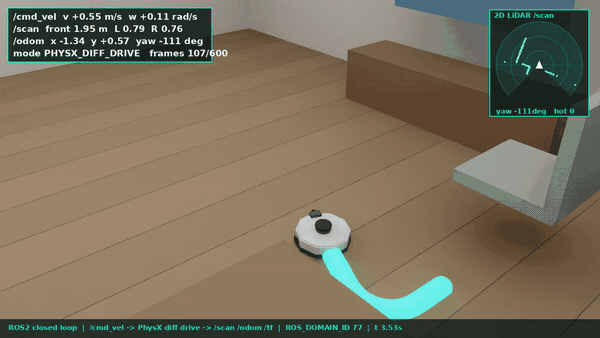
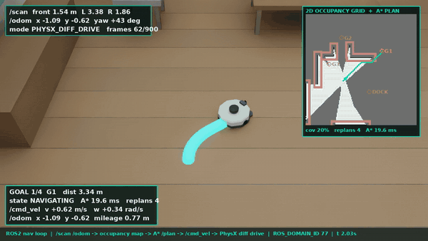
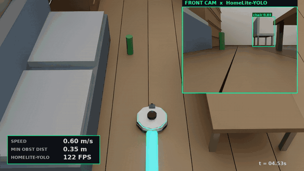
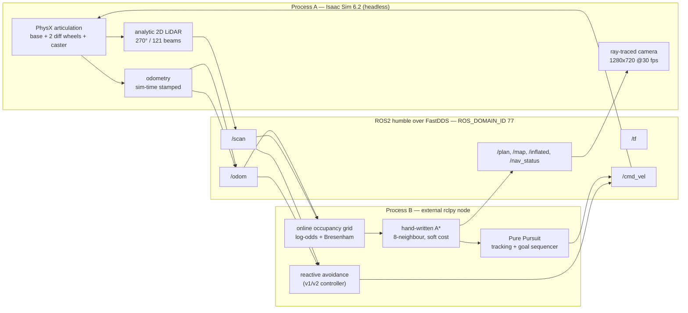

# Isaac Sweeper ROS2 — PhysX differential-drive sweeper with a full ROS2 autonomy stack

A low-cost floor-cleaning robot built **entirely inside NVIDIA Isaac Sim 6.2** (no URDF import, no ground-truth shortcuts) and driven by an **external ROS2 process** over real DDS. Two demos are included: a reactive closed-loop obstacle avoidance run, and a full **online occupancy mapping → A\* global planning → Pure Pursuit tracking** navigation mission.

Both processes run on a stock Isaac Sim 6.2 / Isaac Lab environment that ships the ROS2 **humble** runtime as an extension — there is **no system-wide ROS2 installation**, everything is wired up from the bundled `isaacsim.ros2.core` bundle.



*Closed loop: `/cmd_vel` → PhysX differential wheels → `/scan` + `/odom` → external `rclpy` controller → `/cmd_vel`. 20 s, 8.44 m of true physical travel.*



*Autonomy: the occupancy grid top-right is built **only** from `/scan`; the green line is a hand-written A\* plan published on `/plan`, tracked by Pure Pursuit. Three goals plus a return-to-dock leg, 30 s, 73 % of the room mapped, shot from a fixed overhead gimbal that never cuts.*



*A separate perception render (weights and training code are not part of this repo).*

---

## 1. What is actually simulated

* **Real rigid-body physics.** The chassis is a `UsdPhysics` articulation: one base disc + two `RevoluteJoint` wheels driven by `DriveAPI("angular")` + a passive front caster ball. Motion is *never* animated — the robot only moves because PhysX integrates the wheel torques.
* **Real differential drive.** `Twist` is decomposed as `v_l = v - w·L`, `v_r = v + w·L` (half-track `L = 0.155 m`), converted to wheel angular targets through the measured speed-drive gain.
* **Real 2D LiDAR.** A 270° / 121-beam `/scan` (`sensor_msgs/LaserScan`, 3.5 m range) built by analytic ray casting against the room walls and the furniture AABBs. (`raycast_closest` returns no hits on this stage — see the challenges section.)
* **Real ROS2 across processes.** Process A (Isaac Sim) and process B (`rclpy`) are *separate OS processes* talking over `ROS_DOMAIN_ID=77` / `rmw_fastrtps_cpp`. No shared memory, no in-process shortcuts.

## 2. Architecture



* `src/ros_nav_sim.py` — process A for the navigation demo (900 frames = 30 s @ 30 fps). Subscribes `/cmd_vel`, publishes `/scan`, `/odom`, `/tf`, and subscribes `/plan` / `/map` / `/inflated` / `/nav_status` purely for the on-screen RViz-style overlay. The third-person camera is a **fixed-azimuth overhead gimbal**: it always sits 2.6 m south of the robot at 2.85 m height and never follows the robot's yaw, with an EMA filter (α = 0.06) on both the camera position and the look-at point, so there is no shot-to-shot cut and no wall clipping.
* `src/nav_planner_node.py` — process B for the navigation demo. **Reads no ground-truth map**: occupancy grid (0.05 m/cell), multi-source BFS distance field for inflation (lethal 0.15 m / soft cost out to 0.35 m), 8-neighbour A\* (unknown cells passable with an extra cost), Pure Pursuit at 0.45 m look-ahead, four waypoints (three goals + dock return), `/plan` replanned every 0.5 s of **simulated** time or immediately when the current path is invalidated by a new obstacle.
* `src/ros_sweeper_sim.py`, `src/ros_avoid_controller.py` — the v1/v2 reactive closed-loop pair used for the first demo.
* `src/ros2_preload.py` — the loader that makes the bundled ROS2 humble runtime usable inside Kit (see challenge #1).

## 3. Measured results

| Metric | Closed-loop demo (v2) | Navigation demo (v3) |
|---|---|---|
| Simulation length | 600 frames / 20.00 s | 900 frames / 30.00 s |
| Drive mode | `PHYSX_DIFF_DRIVE` | `PHYSX_DIFF_DRIVE` |
| Distance travelled (in-sim / `/odom`) | 8.44 m / 8.44 m | 13.92 m / 13.92 m |
| `/scan` published → received | 600 → 599 | 900 → 899 |
| `/odom` published → received | 600 → 599 | 900 → 899 |
| `/cmd_vel` published → received | 1485 → 300 (last-value sampling) | 3639 → 169 (last-value sampling) |
| Close-range avoidance events | 3 (0.45 m → 0.49 m → 0.38 m) | 4 (0.45 m → 0.57 m → 0.51 m → 0.58 m) |
| Mapping coverage (known cells) | — | 73.1 % |
| A\* replans / plan latency | — | 53 / ~3 ms (peak 25 ms on the first frame) |
| Goals reached (< 0.28 m, no skipping) | — | 4 / 4 (G1 → G2 → G3 → DOCK), arrival errors 0.27 / 0.27 / 0.27 / 0.11 m |
| Video | 1280×720, 30 fps, 5.86 Mbps | 1280×720, 30 fps, 5.91 Mbps |

> The two `/scan` / `/odom` columns prove the topics really cross the process boundary; the last-value `/cmd_vel` sampling is expected — process A takes one `Twist` per physics step.

## 4. Engineering challenges & fixes

These are the four things that actually blocked the project, and how each was solved. They are the interesting part, not the rendering.

1. **Bundled ROS2 cannot be `dlopen`-ed by name.** The Kit process ignores `LD_LIBRARY_PATH` for bare library names, and `isaacsim.ros2.bridge` additionally has a path-concatenation defect: it resolves `.../isaacsim.ros2.core/humble/` + `lib` + `librosidl_runtime_c.so`, i.e. it looks for a file literally named `liblibrosidl_runtime_c.so`, which does not exist.
   *Fix:* before `set_extension_enabled("isaacsim.ros2.bridge", True)`, preload every bundled `.so` by **absolute path** with `ctypes.CDLL(path, mode=os.RTLD_GLOBAL)` (344/348 loaded, the rest are intentionally incompatible), so the later fallback lookup always hits an already-mapped symbol. See `src/ros2_preload.py`.

2. **Simulation clock vs wall clock.** Headless off-screen rendering runs at ~0.1× real time (one 30 fps frame ≈ 0.3 s of wall clock). A controller that decides "I have not moved for 2.5 s, I must be stuck" on `time.time()` therefore fires **in the middle of an empty 3.5 m corridor** and commands `v = -0.20 m/s` recovery reversals — the robot jitters two steps forward, one step back, and covers 1.69 m in 20 s.
   *Fix:* every timestamp in `/scan`, `/odom`, `/tf` is the **simulation** time (`frame / 30`), all controller timeouts are expressed in that time base (stuck = 90 frames = 3.0 s *and* `/scan` min range < 0.55 m, so open space can never trigger it), and wall clock is used only for process liveness.

3. **PhysX speed drive reaches only ~49 % of the commanded wheel speed.** Measured 8.75°/frame against 16.8°/frame commanded, while wheel rotation and body displacement stay in exact agreement (no slip) — so it is a drive-gain property of this build, not friction.
   *Fix:* calibrate a constant gain (`W_GAIN = 2.05`) in the wheel target speed conversion; a 0.55 m/s command then produces ≈0.42 m/s of real motion, and the 20 s run went from 1.69 m to 8.44 m.

4. **`psutil` version lock in the Kit environment.** The Isaac Sim/Isaac Lab Python 3.12 environment installs a `psutil` build that breaks the extension manager's process probes.
   *Fix:* pin `psutil==5.9.8` inside the environment (no `sudo`, no driver changes).

Three smaller ones worth knowing: a **status-queueing lag** made the HUD show `dist 0.60 m` while the robot was already 0.08 m from the goal (fix: `/nav_status` publishes every simulation frame with queue depth 1, and the displayed distance is never forced to 0); `UsdPhysics.Scene` must exist or PhysX never steps (the robot silently stands still), and `UsdGeom.XformCache` must **not** be reused across frames if you want live poses — a cached cache returns the opening pose forever and makes odometry look frozen at 0.

## 5. Repository layout

```
.
├── assets/                     # palette-optimised GIFs used by this README
├── docs/
│   ├── ros2_closed_loop_report.md
│   └── nav_v3_report.md
├── src/
│   ├── ros2_preload.py         # RTLD_GLOBAL preload of the bundled ROS2 humble libs
│   ├── ros_sweeper_sim.py      # process A (reactive demo)
│   ├── ros_avoid_controller.py # process B (reactive demo)
│   ├── ros_nav_sim.py          # process A (navigation demo)
│   ├── nav_planner_node.py     # process B (mapping + A* + Pure Pursuit)
│   ├── run_all_closed_loop.sh
│   ├── run_all_nav_v3.sh
│   ├── report_gen_v2.py
│   └── report_gen_nav_v3.py
├── LICENSE
└── README.md
```

## 6. Running it

Requirements: Isaac Sim 6.2 (Isaac Lab 3.0 python 3.12 env), a CUDA GPU, `ffmpeg` for the encode step.

```bash
# point these at your own installation (no personal paths are hard-coded)
export ISAACSIM_ROS2_CORE=/path/to/isaacsim/exts/isaacsim.ros2.core
export ROS2_PRELOAD_DIR=/path/to/ros2_preload          # dir containing ros2_preload.py + ros2_env.sh
export ISAACLAB_PYTHON=/path/to/envs/isaaclab/bin/python
export ROS_DOMAIN_ID=77

bash src/run_all_nav_v3.sh      # 900 frames, background, auto-picks a free GPU
```

The scripts pick the freest GPU (`memory.used < 4 GB`, `util < 20 %`), run headless with `setsid nohup`, then encode the PNG sequence with `ffmpeg` and write a Markdown report.

## 7. 中文要点

* **真物理 + 真 ROS2**：Isaac Sim 6.2 里的 PhysX 差速轮扫地机，与一个**独立进程**的 `rclpy` 节点通过 FastDDS 跨进程通信，`/scan`、`/odom`、`/tf`、`/cmd_vel` 全部真实收发，不是动画。
* **两级自主性**：先做反应式近距避障（20 s 走 8.44 m，3 次真实近距绕障），再升级为**在线占据栅格建图（Log-Odds + Bresenham）→ 膨胀代价层 → 手写 8 邻域 A\* → Pure Pursuit 跟踪 → 三目标点导航**，全程不读任何真值地图。
* **四个硬核坑**：内置 ROS2 需要 `RTLD_GLOBAL` 预加载才能绕过 `liblibrosidl_runtime_c.so` 拼接缺陷；仿真时钟与墙钟错配会让控制器在大空地里误判卡死；PhysX 速度驱动只有指令的约 49%，需要增益标定；`psutil==5.9.8` 依赖锁。
* 视频与报告都在 `assets/`、`docs/` 下；HomeLite-YOLO 的权重与训练源码**不包含**在本仓库中。
